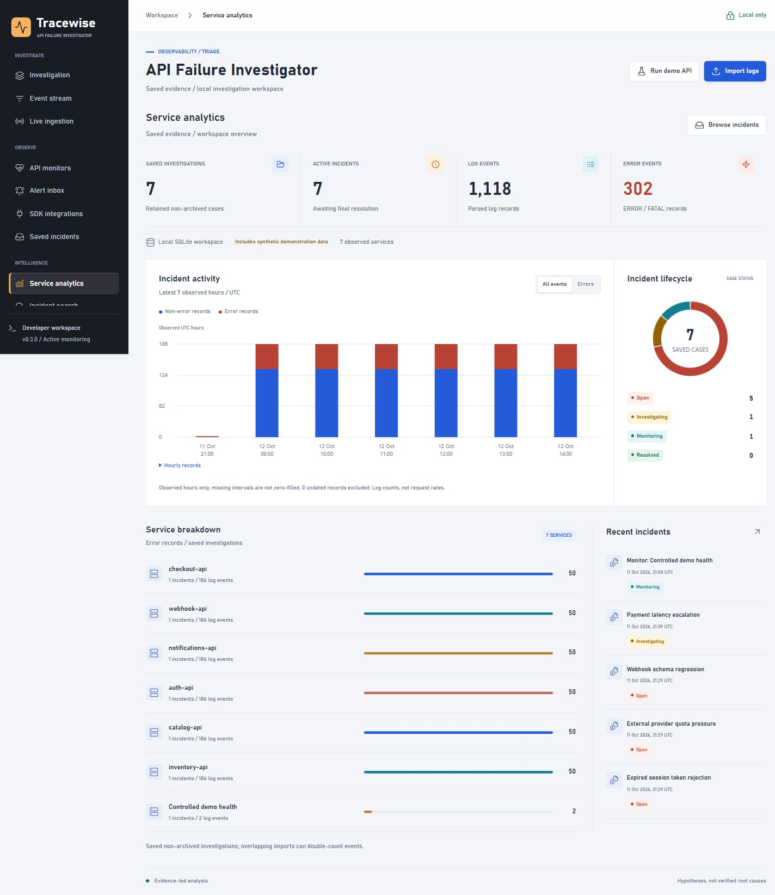

# API Failure Investigator

A local-first developer tool for investigating API failures from logs.
The dashboard groups recurring errors, displays a timeline, links each finding
to source evidence, and explicitly abstains when no supported pattern matches.

**Version 0.4 adds controlled remote monitoring and authenticated operations:** SQLite-backed case
management, lifecycle edits, activity trails, cross-incident TF-IDF retrieval,
Isolation Forest analysis, live ingestion, service analytics, comparison and runbooks. Error
diagnoses remain evidence-led rules, not an LLM or autonomous root-cause engine.
No API key or external AI service is required. ML dependencies are installed
once; log analysis stays local. Explicitly configured HTTPS monitors and webhook alerts make external requests.

Active HTTP monitors now add configurable status/latency thresholds, scheduled
checks, deduplicated alerts, acknowledgement, automatic evidence snapshots and
recovery-to-monitoring transitions. Python and Node.js SDKs connect local apps.
There are 13 workspace views. Public HTTPS monitoring is an explicit administrator
allowlist opt-in. Account login supports admin, operator and viewer roles, and a
transactional webhook outbox provides bounded retries and visible delivery failures.
See [operations setup](docs/OPERATIONS.md) for accounts, egress and HTTPS proxy configuration.



See [verification notes](docs/VERIFICATION.md) for tested workflows and remaining
verification limits.

## Run

Python 3.11 or newer:

```powershell
cd api-failure-investigator
python server.py --port 8790
```

Open http://127.0.0.1:8790. If the port is occupied, choose a different port.
Stop with Ctrl+C. The server binds to loopback only. Authentication is disabled
in this default local mode. Remote access requires provisioned accounts, an exact
HTTPS public origin, and a hardened reverse proxy; it is not deployed by default.

For the complete ML feature set, create an independent environment first:

```powershell
python -m venv .venv
.venv\Scripts\python.exe -m pip install -r requirements.txt
.venv\Scripts\python.exe server.py --port 8790
```

Without scikit-learn, core investigations and case management still run;
ML views explicitly report unavailable dependencies. The current development
preview uses an already-installed Python environment; the project itself does
not import source code from the separate benchmark project.

Workspace data defaults to `storage/workspace.sqlite3`, ignored by Git. Override
with `--db PATH`; use `--db :memory:` for an ephemeral workspace. To back up a
workspace, stop the server first and copy the database. Restart preserves saved
cases; browser clear/reload only resets the active unsaved view.

## Workflows

- **Sample investigation:** bundled synthetic checkout incident, 14 events,
  seven errors and four error groups. Not production evidence.
- **Import logs:** file selection, drag/drop, or pasted UTF-8 content.
- **Investigation:** service/search filters, per-minute timeline, grouped
  signatures, pattern-based findings, checklists, evidence, and request traces.
- **Event stream:** searchable, service/level-filtered, paginated raw events
  after normalization and best-effort redaction.
- **Controlled demo:** 15 real loopback HTTP calls, yielding 30 log events
  and 10 deliberately injected failure events. No external dependency is called.
- **Live ingestion:** rolling 1,000-event memory buffer, automatic refresh,
  pause/resume, threshold alerts and snapshot-to-investigation workflow.
- **API monitors:** persisted settings/check history, background scheduler,
  response-header latency chart, expected-status and latency thresholds.
- **Alert inbox:** consecutive failures, deduplication, acknowledgement,
  recovery thresholds and configurable new-alert cooldown.
- **Automatic incidents:** separately enabled failure-evidence retention;
  recovery moves eligible cases to monitoring, never automatically resolved.
- **SDK integrations:** dependency-free Python logging/capture and Node.js
  event/capture clients with bounded telemetry and observable delivery failures.
- **Export:** normalized records, source-line IDs, evidence references,
  timeline counts, parse issues, and limitations as JSON. Local checkmarks
  are UI state, not evidence, and are not included in the export.
- **Saved incidents:** explicit retention consent, priority, owner label,
  open/investigating/monitoring/resolved/archived lifecycle, redacted notes and
  database-backed activity trail. Stale edits return HTTP 409.
- **Service analytics:** error-event totals, lifecycle counts, recent activity
  and per-service volume from non-archived saved investigations.
- **Incident search:** scikit-learn TF-IDF + cosine similarity across titles,
  service names and grouped messages, with direct links to saved evidence.
- **Anomaly analysis:** actual Isolation Forest fitted to observed-minute
  features; at least 12 windows required, deterministic seed 42.
- **Compare incidents:** exact service/signature presence and count differences.
- **Runbooks:** five manual diagnostic checklists; no automated remediation.
- **Demo workspace:** six explicitly synthetic multi-service cases, each with
  24 observed minutes and 186 events. Seeding is idempotent.
- **Saved exports:** server-generated JSON evidence and Markdown incident
  reports via same-origin attachment endpoints.

See [API reference](docs/API.md) and [architecture](docs/ARCHITECTURE.md).
For the active workflow, SDK examples and exact alert semantics, see
[monitoring guide](docs/MONITORING.md).

## Connect Local Logs

Send a UTF-8 JSONL, JSON array or supported CSV file from PowerShell:

```powershell
$body = @{content = Get-Content -Raw -LiteralPath ./samples/checkout.jsonl} | ConvertTo-Json
Invoke-RestMethod -Method Post -Uri http://127.0.0.1:8790/api/ingest -ContentType application/json -Body $body
```

Open **Live ingestion** to inspect the feed. The controlled demo also appends
its generated logs. This is local HTTP ingestion with browser polling, not a
durable message broker. The latest 100 events are displayed; at most 1,000 are
retained in memory. Pause stops display refresh, not ingestion. The alert rule
requires at least 10 events and 20% ERROR/FATAL among the latest 100 events.
It is a log-event threshold, not ML or a request failure-rate measurement.
Clear buffer or a server restart removes live events. Saving an investigation
is a separate explicit action; only saved snapshots survive restart.

## Local ML Boundaries

TF-IDF is **lexical retrieval**, not semantic embeddings. Cosine similarity is
not root-cause confidence. Isolation Forest uses log event counts, log error
counts, error-event fraction, and log warning counts; its decision scores are
not probabilities. It fits and scores the same investigation for descriptive
outliers, not held-out predictive performance. Missing minute buckets are not
invented. The synthetic workspace demonstrates behavior, not real-world model
accuracy. Identical feature windows abstain from flagging relative anomalies.

## Input Contract

JSONL (one object per line), JSON arrays, or CSV with headers:

```json
{"timestamp":"2026-10-12T09:00:00Z","level":"ERROR","service":"checkout-api","message":"Payment request timed out after 3000ms","request_id":"req-1","status":504,"path":"/checkout"}
```

`message` is required. Timestamp, level, service, request ID, HTTP status,
method, and path are optional. Common aliases include `msg`, `severity`,
`ts`, `app`, `trace_id`, and `status_code`. Missing levels default to INFO;
HTTP 5xx records are promoted to ERROR. WARNING maps to WARN and CRITICAL
maps to FATAL. Structured message objects are serialized as text.

CSV should start with `timestamp`, `time`, `level`, or `service`. Plain text:

```text
2026-10-12T09:00:00Z ERROR checkout-api | Connection refused
```

Limits: 4 MiB and 10,000 records per investigation. Malformed lines or
records without messages are skipped and reported. Undated records remain
available but are excluded from the timeline. Timestamps without an offset
are interpreted as UTC. For multiline stack traces, use a structured message
field rather than standalone continuation lines.

## Diagnosis Boundaries

Supported explicit patterns: dependency connection failures, timeouts,
connection pool exhaustion, rate limits, and authentication/access rejections.
Findings describe observed symptoms and competing hypotheses, not proven
causes. Unknown failures return **Insufficient evidence**. No probabilistic
confidence scores are invented.

Only ERROR/FATAL and HTTP 5xx records form groups; WARN/INFO remain in the
timeline and stream. Grouping uses service plus normalized message text,
including numeric values and common IDs. It may overmerge or split real
incidents; evidence must be inspected. Request traces are exact request-ID
matches, not inferred causal graphs. The timeline uses observed minute buckets;
missing intervals are not asserted to have zero traffic. Error percentages
refer to log events, not requests.

## Privacy and Security

- Uploaded content is not sent to an external service. Unsaved analysis is
  transient; **explicitly saved normalized logs and notes are retained locally
  in SQLite**, including archived investigations. Redaction is reapplied on save.
- Creating a monitor requires retention consent. Monitor settings and check
  history persist; automatic incident evidence persists only when separately
  enabled. Scheduled monitoring continues while this process runs, even if
  the browser closes. Enabled monitors resume after server restart.
- Saved snapshots are reparsed on the server. Source positions are reindexed;
  original skipped-line diagnostics belong to the initial unsaved analysis.
- Browser clear/reload does not erase saved data. The rolling ingestion buffer
  survives browser reload, but not server restart or Clear buffer. Controlled
  demo requests also append to that buffer. No localStorage is used.
- Common secret fields, Bearer/Basic values, credential assignments, and
  URL username/password pairs receive best-effort redaction before analysis.
- Redaction does **not** guarantee all secrets or personal data are removed.
  Review sensitive files before import and review exports before sharing.
- Same-origin JSON mutations, a local host allowlist, static path confinement,
  and CSP reduce accidental exposure. They are not a substitute for production
  authentication, access control, resource limits, or a security review.
- Do not expose this Python development server to the internet. Public hosting
  requires a hardened backend and an explicit retention/access policy; static
  Netlify hosting alone cannot run the Python backend.

## Tests

```powershell
python -m unittest discover -s tests -v
node --check web/app.js
node --check web/platform.js
node --check web/monitoring.js
node --test tests/sdk.test.mjs
```

Tests cover parsing, timestamps, grouping, evidence references, known/unknown
findings, redaction, limits, HTTP endpoints, injected failures, cross-origin
rejection, host validation, and path traversal. Controlled fixtures do not
establish production diagnostic accuracy. Additional tests cover persistence,
optimistic concurrency, recoverable archiving, notes, actual ML behavior,
retrieval ranking, deterministic outlier scores and saved report endpoints.
There are 143 Python tests and four Node SDK tests. Coverage includes live
retention, URL restrictions, actual HTTP probes, background scheduling,
concurrent alert deduplication, recovery, cooldown and transactional rollback.

## Structure

```text
investigator/analysis.py   parsing, normalization, redaction and findings
investigator/store.py      SQLite case lifecycle, notes and audit events
investigator/intelligence.py  TF-IDF, Isolation Forest and case comparison
investigator/fixtures.py   explicitly synthetic multi-service scenarios
investigator/stream.py     bounded ingestion and threshold alerts
investigator/monitoring.py scheduler, HTTP probes, alerts and automatic cases
investigator/outbound.py   HTTPS allowlist, DNS validation and pinned TLS sockets
investigator/access.py     provisioned accounts, role checks and expiring sessions
investigator/delivery.py   transactional webhook queue, retries and delivery state
sdk/                      dependency-free Python and Node.js telemetry
server.py                 local HTTP API and controlled failure endpoint
web/                      buildless dashboard and vendored icons
web/platform.js           history, analytics, ML and management views
samples/checkout.jsonl    labelled synthetic demonstration
tests/                    unit and real HTTP integration tests
```

## Next Iterations

Evaluate against independently labelled incidents, add explicit adapters for
real logging formats, and measure grouping quality and unsupported-pattern
coverage. Semantic embeddings or an optional LLM can later extend findings
without replacing evidence references and abstention. Multi-tenant isolation,
SSO/MFA, distributed scheduling, durable SDK ingestion and real distributed
tracing are not implemented. Accounts share one workspace; owner remains an
editable label, not an authorization boundary. Mutation records identify the
signed-in account but are local application records, not tamper-proof logs.
No public deployment, real-incident accuracy claim or autonomous repair is implied.

Lucide icons: version 0.468.0, ISC license; see `web/vendor/LICENSE.txt`.
